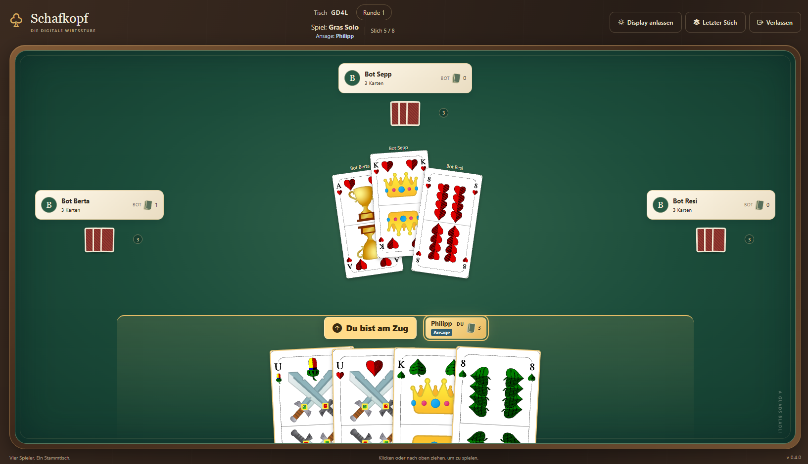

[](https://github.com/ipax77/pax.schafkopf/actions/workflows/dotnet.yml)

# pax.Schafkopf

A sample implementation of the traditional Bavarian card game **Schafkopf**, built as a real-time multiplayer web application using **Blazor** and **SignalR**.

The project serves as a reference for building interactive, stateful web applications with modern .NET.

## Website
[schafkopf.pax77.org](https://schafkopf.pax77.org)


## Getting Started

> Requires **.NET 10 SDK**

### Clone the repository
```bash
git clone https://github.com/ipax77/pax.schafkopf.git
```

### Start the API
Start the backend API first:
```bash
cd pax.schafkopf/src/sk.api
dotnet run
```

### Start the Web App
In a second terminal:
```bash
cd pax.schafkopf/src/sk.pwa
dotnet run
```

Open http://localhost:5027
 in four different browsers or browser profiles.
Each browser represents one player in the game.

## Headless engine and bots

The [WSL training plan](docs/training-plan.md) defines separate bidding and playing models,
staged PPO training, and the implementation milestones.

See [the engine contract](docs/engine.md) for deterministic simulation, supported rules,
stable action IDs, seat-limited observations, and live bot integration hooks.
Run the simulation check with `dotnet run --project tools/sk.simulation-audit -c Release -- 1000000`.
See [engine benchmarks](src/sk.benchmarks/README.md) for repeatable throughput/allocation measurements
and the results of the first two optimization rounds.

# Contributing

We really like people helping us with the project. Nevertheless, take your time to read our contributing guidelines [here](./CONTRIBUTING.md).

## License
GPLv3
